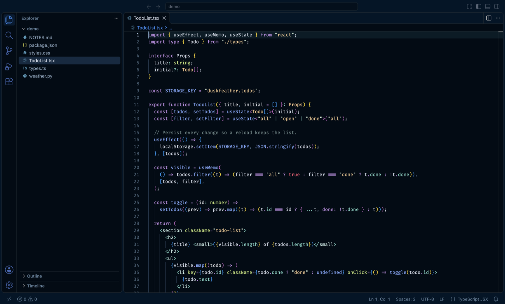
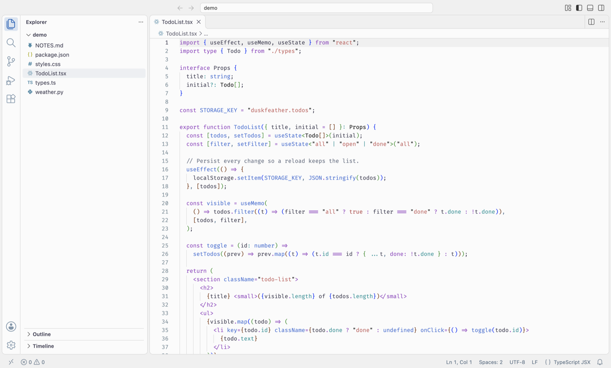

# Duskfeather

[](https://marketplace.visualstudio.com/items?itemName=anngth.duskfeather)
[](https://marketplace.visualstudio.com/items?itemName=anngth.duskfeather)

A VS Code theme based on **Night Owl (No Italics)**, in dark and light. Deep cards sit on a slightly lighter shell, borders are a single gray, the accent is VS Code blue, and nothing is italic. Syntax colors stay as in Night Owl, with comments lifted for contrast.

## Install

1. In VS Code, open the Extensions view (`Cmd+Shift+X` on macOS, `Ctrl+Shift+X` on Windows and Linux).
2. Search for **Duskfeather** (publisher **anngth**) and click *Install*.
3. Run *Preferences: Color Theme* (`Cmd+K Cmd+T` / `Ctrl+K Ctrl+T`) and pick **Duskfeather** or **Duskfeather Light**.

Or press `Cmd+P` / `Ctrl+P` and run:

```
ext install anngth.duskfeather
```

From a terminal:

```bash
code --install-extension anngth.duskfeather
```

You can also install it from the [Marketplace page](https://marketplace.visualstudio.com/items?itemName=anngth.duskfeather).

## Duskfeather



## Duskfeather Light



## Build from source

```bash
npm run package
code --install-extension duskfeather-*.vsix
```

To try it without installing, open this folder in VS Code and press `F5`. The `demo/` folder has sample files to look at.

## Edit colors

UI colors live in `palette.json`, under `dark` and `light`. After editing:

```bash
npm run build   # regenerate both theme files in themes/
npm run check   # validate them
```

## Credits

Based on [Night Owl](https://github.com/sdras/night-owl-vscode-theme) by Sarah Drasner, MIT License. See [LICENSE.md](LICENSE.md).
